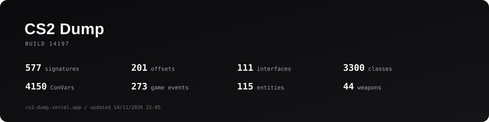

<p align="center">
  
</p>

<p align="center">
  <a href="https://cs2-dump.vercel.app/">cs2-dump.vercel.app</a><br>
  <sub>Last updated 18/11/2026 22:05</sub>
</p>

## Output

```text
output/
  build-14198/
    client_dll.json / .hpp / .cs / .rs / .zig
    engine2_dll.json / .hpp / .cs / .rs / .zig
    server_dll.json / .hpp / .cs / .rs / .zig
    ...
    offsets.json / .hpp / .cs / .rs / .zig
    offsets_all.json
    interfaces.json / .hpp
    buttons.json / .hpp
    info.json
    build.json
    hashes.json
    patterns.json / .hpp
    calibrated_patterns.json
    scanner_patterns.txt
    scanner_out.json
    rva.json                  name -> RVA (functions, globals, vtables, interfaces)
    callsites.json            direct E8 call sites and RIP-relative data refs
    schema_offsets.json       class -> field -> byte offset
    enums.json                enum members and values
    chains.json / .hpp        entity list, identity, class, schema-name chains
    compat.json               contract manifest and counts
    vpk/
      manifest.json
      overviews/
      radar_raw/
    sdk/
```

The same files are mirrored to `cs2-dumper/output/build-14198/`.

## Compatibility layer

`/api/compat.json` is the entry point for any cheat/updater:

| endpoint | content |
| --- | --- |
| `/api/rva.json` | `name -> { rva, kind, source }`, per module |
| `/api/callsites.json` | for every target: direct `E8` call sites with wildcarded rel32, plus RIP-relative data refs |
| `/api/schema_offsets.json` | `class -> fields[name] = byte offset` |
| `/api/enums.json` | enum members and values |
| `/api/chains.json` | engine pointer chains with per-step offsets |
| `/api/chains.hpp` | the same chains as C++ constants |

A generic updater only needs three steps: resolve an old literal to its target RVA, look that RVA up in
`rva.json`, then take the new bytes from `callsites.json` (call sites) or `patterns.json` (function starts).
No name mapping is required.

Chains verified on build 14197:

```text
entity_list      dwEntityList -> +0x10 chunk table, stride 8, index&0x1FF * 0x70
entity_identity  entity + 0x10
entity_class     identity + 0x8
schema_class_info  class + 0x58
schema_class_name  class_info + 0x8
```

`CEntityIdentity::GetClassName` is published at `0xB64160` (`edx = entity index`); it applies the last three
steps and returns the class name. The offsets above were confirmed against that function, not just against the
schema.

## Repository layout

```text
cs2-dumper/
  bin/              release binaries
  site/             React + Vite site
  docs/             built site and published data
  assets/           VPK assets (maps, workshop, icons, characters)
  output/           current dump by build
  cs2-dumper/       publishing repository
```

Only the three most recent builds are kept.
