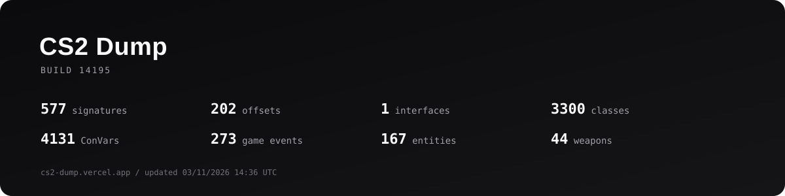

<p align="center">
  
</p>

<p align="center">
  <a href="https://cs2-dump.vercel.app/">cs2-dump.vercel.app</a><br>
  <sub>Last updated 03/11/2026 14:31</sub>
</p>

## Output

```text
output/
  build-14195/
    client_dll.json / .hpp / .cs / .rs / .zig
    engine2_dll.json / .hpp / .cs / .rs / .zig
    server_dll.json / .hpp / .cs / .rs / .zig
    ...
    offsets.json / .hpp / .cs / .rs / .zig
    offsets_all.json
    interfaces.json / .hpp
    buttons.json / .hpp
    info.json
    build.json
    hashes.json
    patterns.json / .hpp
    calibrated_patterns.json
    scanner_patterns.txt
    scanner_out.json
    vpk/
      manifest.json
      overviews/
      radar_raw/
    sdk/
```

The same files are mirrored to `cs2-dumper/output/build-14195/`.

## Repository layout

```text
cs2-dumper/
  bin/              release binaries
  site/             React + Vite site
  docs/             built site and published data
  assets/           VPK assets (maps, workshop, icons, characters)
  output/           current dump by build
  cs2-dumper/       publishing repository
```

Only the three most recent builds are kept.
